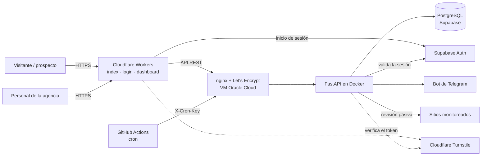

# Especificación de requerimientos

| | |
|---|---|
| **Proyecto** | Sistema web de diagnóstico y monitoreo de sitios web para optimizar el mantenimiento y la captación de clientes en una agencia de marketing digital, Lima 2026 |
| **Organización** | Grupo ConsigueVentas Inversiones E.I.R.L. |
| **Autor** | Giovanni Joaquín Garcilazo López · Ingeniería de Sistemas, Universidad César Vallejo |
| **Versión** | 2.0 |
| **Fecha** | 20/10/2026 |

**Leyenda de estado:** ✅ Implementado · ⏳ Pendiente

---

## 1. Introducción

### 1.1 Propósito

Este documento describe qué hace el sistema (requerimientos funcionales), bajo qué condiciones lo hace (reglas de negocio y requerimientos no funcionales) y cómo se relaciona cada requerimiento con los componentes construidos.

### 1.2 Alcance

El sistema tiene dos módulos que comparten la misma base de datos y el mismo servidor:

1. **Panel interno de monitoreo.** Revisa de forma periódica los sitios web de los clientes de la agencia (disponibilidad, certificado SSL y tiempo de respuesta), guarda el historial, calcula caídas y disponibilidad, avisa por Telegram cuando algo cambia y permite administrar sitios, contactos, usuarios y ajustes. El acceso es restringido por cuenta y por rol.
2. **Diagnóstico público con captación de leads.** Una página abierta donde cualquier persona analiza su sitio web de forma gratuita y recibe un puntaje en cinco categorías. Para ver el informe completo deja sus datos de contacto, que quedan registrados para la agencia.

El sistema realiza únicamente **revisiones pasivas desde el exterior**: observa lo que cualquier visitante ya puede ver. No accede al interior de los sitios analizados ni los modifica.

---

## 2. Descripción general

### 2.1 Actores

| Actor | Descripción |
|---|---|
| **Administrador** | Personal de la agencia con acceso completo al panel. |
| **Lector** | Personal de la agencia que consulta el estado de los sitios y los incidentes, sin administrar. |
| **Visitante / prospecto** | Persona externa que usa el diagnóstico gratuito. No tiene cuenta. |
| **Planificador** | Proceso automático (GitHub Actions) que dispara los chequeos programados con una clave de servicio. |

### 2.2 Restricciones y supuestos

- **Costo cero:** toda la infraestructura utiliza planes gratuitos.
- El monitoreo se hace desde fuera de los sitios; no se requiere acceso a su contenido interno.
- La agencia autoriza el monitoreo de los sitios de sus clientes que se registran en el sistema.
- El servidor (VM de Oracle Cloud) permanece encendido las 24 horas.
- Algunos hostings bloquean las visitas automáticas (HTTP 403). El sistema envía las cabeceras de un navegador para reducir estos falsos positivos.

---

## 3. Requerimientos funcionales

### 3.1 Seguridad y acceso

| ID | Requerimiento | Prioridad | Estado |
|---|---|---|---|
| RF-01 | Autenticación con correo y contraseña (Supabase Auth). El registro público está deshabilitado; las cuentas las crea un administrador. | Alta | ✅ |
| RF-02 | Control de acceso por roles (`admin` y `lector`). Una cuenta sin rol no accede y ve un mensaje claro. | Alta | ✅ |
| RF-03 | Cierre de sesión seguro: revoca la sesión en el servidor, redirige al inicio de sesión y no permite volver al panel con el botón «Atrás». | Alta | ✅ |
| RF-04 | Cierre automático de la sesión tras 30 minutos sin actividad, también entre varias pestañas. | Media | ✅ |

### 3.2 Monitoreo

| ID | Requerimiento | Prioridad | Estado |
|---|---|---|---|
| RF-05 | Chequeo de disponibilidad: código HTTP y tiempo de respuesta, con cabeceras de navegador. | Alta | ✅ |
| RF-06 | Verificación del certificado SSL y de los días restantes para su vencimiento. | Alta | ✅ |
| RF-07 | Chequeos automáticos programados (GitHub Actions) y manuales (individual y masivo). | Alta | ✅ |
| RF-08 | Historial de chequeos por sitio. | Alta | ✅ |
| RF-09 | Disponibilidad (uptime) de los últimos 7 y 30 días por sitio. | Media | ✅ |
| RF-10 | Alertas por Telegram: un solo mensaje resumen por ronda, solo ante cambios de estado, y aviso de SSL por vencer. | Alta | ✅ |

### 3.3 Panel

| ID | Requerimiento | Prioridad | Estado |
|---|---|---|---|
| RF-11 | Resumen general (sitios registrados, disponibles y caídos), con filtro al pulsar cada tarjeta. | Media | ✅ |
| RF-12 | Búsqueda por nombre o URL, filtros por estado y ordenamiento (nombre, caídos primero, más lentos, SSL por vencer). | Media | ✅ |
| RF-13 | Detalle por sitio: disponibilidad a 30 y 7 días, tendencia del tiempo de respuesta, última caída e historial reciente. | Media | ✅ |
| RF-14 | Navegación por secciones (Panel, Sitios, Leads, Incidentes, Usuarios, Actividad y Ajustes), mostrando a cada rol solo lo que le corresponde. | Media | ✅ |

### 3.4 Administración

| ID | Requerimiento | Prioridad | Estado |
|---|---|---|---|
| RF-15 | Gestión de sitios: agregar, editar, pausar, reanudar, ocultar, mostrar y eliminar. Solo administradores. | Alta | ✅ |
| RF-16 | Gestión de leads: ver, cambiar estado, anotar seguimiento, contactar por WhatsApp o correo, eliminar y exportar a Excel. Solo administradores. | Alta | ✅ |
| RF-17 | Gestión de usuarios: ver cuentas, cambiar rol, quitar acceso, suspender y reactivar. Solo administradores. | Alta | ✅ |
| RF-18 | Registro de incidentes: cuándo cayó cada sitio, cuánto duró y si sigue abierto, con filtros por periodo, sitio y estado. | Media | ✅ |
| RF-19 | Registro de actividad: quién hizo qué y cuándo, para las acciones de administración. Solo administradores. | Media | ✅ |
| RF-20 | Ajustes: interruptor del diagnóstico público, umbral del aviso de SSL y mensaje de prueba a Telegram. Solo administradores. | Media | ✅ |

### 3.5 Diagnóstico público y captación de leads

| ID | Requerimiento | Prioridad | Estado |
|---|---|---|---|
| RF-21 | Página pública donde se escribe una URL y se analiza sin registro. | Alta | ✅ |
| RF-22 | Diagnóstico con puntaje global y cinco categorías: Disponibilidad, Certificado SSL, Velocidad, Seguridad y SEO y móvil. | Alta | ✅ |
| RF-23 | Vista previa gratuita (puntajes y resúmenes) e informe completo con hallazgos, «por qué importa» y «cómo corregirlo», una vez que el visitante deja sus datos con consentimiento. | Alta | ✅ |
| RF-24 | Registro del lead en la base de datos: nombre, correo, teléfono (opcional), sitio analizado, puntaje, informe y consentimiento. | Alta | ✅ |
| RF-25 | Aviso por Telegram de cada nuevo lead. | Media | ✅ |
| RF-26 | Protección contra bots y abuso: Cloudflare Turnstile, campo trampa, límites por IP y en el servidor, y validaciones contra el acceso a direcciones internas. | Alta | ✅ |
| RF-27 | Acceso interno a la aplicación desde la página pública, oculto a los visitantes. | Baja | ✅ |

### 3.6 Pendientes

| ID | Requerimiento | Prioridad | Estado |
|---|---|---|---|
| RF-28 | Política de privacidad visible desde el formulario de la página pública. | Alta | ⏳ |
| RF-29 | Puntaje de PageSpeed Insights (rendimiento y Core Web Vitals) en el diagnóstico. | Baja | ⏳ |
| RF-30 | Revisión de la seguridad del correo del dominio (SPF y DMARC) en el diagnóstico. | Baja | ⏳ |
| RF-31 | Informe del diagnóstico descargable en PDF. | Baja | ⏳ |
| RF-32 | Revisión de enlaces rotos. | Baja | ⏳ |

---

## 4. Reglas de negocio

| ID | Regla |
|---|---|
| RN-01 | Un sitio está **disponible** si responde con un código HTTP menor a 400. En el diagnóstico público, los códigos 401, 403 y 429 se interpretan como «bloquea visitas automáticas» (60 puntos) y no como caída. |
| RN-02 | La alerta de **caída o recuperación** se envía solo cuando el estado cambia respecto del chequeo anterior. El primer chequeo de un sitio nuevo solo alerta si está caído. |
| RN-03 | La alerta de **SSL por vencer** se envía cuando faltan los días configurados o menos (entre 1 y 60, por defecto 15) y el número de días cambió respecto del chequeo anterior. |
| RN-04 | El aviso de **sitio lento** (más de 3000 ms) forma parte del chequeo individual y se evalúa junto con el cambio de estado. |
| RN-05 | En el chequeo masivo se envía **un único mensaje resumen** por ronda, y ninguno si no hay novedades. |
| RN-06 | La **disponibilidad (uptime)** es el cociente entre chequeos disponibles y chequeos totales de los últimos 7 y 30 días, con días calculados en hora de Lima (UTC−5). |
| RN-07 | El rol se guarda en los metadatos de aplicación (`app_metadata.rol`) de cada usuario en Supabase. Sin rol no hay acceso (error 403). Un cambio de rol o una suspensión puede tardar hasta un minuto en aplicarse. |
| RN-08 | **Permisos:** ambos roles pueden ver el panel y los incidentes; solo el administrador puede escribir sitios, ver y gestionar leads y usuarios, ver la actividad y cambiar los ajustes. El chequeo masivo lo puede disparar un usuario con rol o la clave de servicio. |
| RN-09 | Un administrador **no puede modificar su propia cuenta** desde la sección Usuarios, para no quedarse sin acceso. |
| RN-10 | Un sitio **en pausa** no se chequea y no aparece en el panel. Un sitio **oculto** se sigue chequeando y avisando, pero no aparece en el panel. |
| RN-11 | Un **incidente** es una racha de chequeos fallidos consecutivos de un sitio. Empieza en el primer chequeo fallido y termina en el primer chequeo correcto que le sigue; si el último chequeo falla, el incidente está abierto. La duración es aproximada y depende de la frecuencia de los chequeos. |
| RN-12 | El **puntaje global** es el promedio ponderado: Disponibilidad 25 %, SSL 20 %, Velocidad 20 %, Seguridad 20 %, SEO y móvil 15 %. Estados: 80 o más = Bien, 50 a 79 = Mejorable, menos de 50 = Crítico. Si el sitio usa HTTPS, Seguridad nunca se muestra como Crítico. |
| RN-13 | **SSL:** más de 30 días = 100; de 16 a 30 días = 70; 15 días o menos = 40; vencido o sin HTTPS = 0. |
| RN-14 | **Velocidad:** se mide hasta tres veces y se usa la mediana. Hasta 800 ms = 100; hasta 1500 ms = 85; hasta 2500 ms = 65; hasta 4000 ms = 40; más de 4000 ms = 20. Descuentos: sin compresión −10, sin caché −5, página pesada −5. |
| RN-15 | **Seguridad** (8 comprobaciones, pesos entre paréntesis): redirección de http a https (10), HSTS (20), protección contra clickjacking (20), nosniff (15), política de contenido CSP (10), política de referrer (10), política de permisos (5) y no exponer versiones de software (10). Una CSP que solo contenga `upgrade-insecure-requests` se considera incompleta. |
| RN-16 | **SEO y móvil** (8 comprobaciones): título (15), meta descripción (15), viewport (15), encabezado H1 (10), HTTPS (10), Open Graph (15), `robots.txt` (10) y `sitemap` (10). Las comprobaciones que no se pueden verificar se excluyen del cálculo. |
| RN-17 | El **informe completo** solo se entrega después de registrar un lead con consentimiento. El análisis permanece en memoria hasta 1 hora. |
| RN-18 | Límites del diagnóstico público: 3 análisis por hora por IP, 40 por hora en total, 2 simultáneos y 5 registros de lead por hora por IP. Además, nginx limita las solicitudes por IP. |
| RN-19 | Cada análisis descarga como máximo 300 KB, sigue hasta 3 redirecciones y solo acepta los puertos 80 y 443. Se bloquean las direcciones que no son públicas (red local, loopback, metadatos de la nube), también en cada redirección. |
| RN-20 | El **interruptor del diagnóstico público** del panel prevalece sobre la variable `AUDITORIA_PUBLICA` del servidor. Mientras nunca se haya cambiado desde el panel, se usa el valor del servidor. Los ajustes se refrescan al instante al guardarlos y, de lo contrario, cada 15 segundos. |
| RN-21 | Los **estados de un lead** son: nuevo, contactado, en proceso, ganado y descartado. Eliminar un lead borra sus datos personales. |
| RN-22 | El **registro de actividad** guarda quién hizo la acción, qué hizo y cuándo, después de que la acción se completó. No guarda datos personales de los leads: solo su número. Si guardar el registro falla, la acción no se revierte. |
| RN-23 | La sesión se cierra tras **30 minutos sin actividad**. Al salir, se revoca la sesión de ese dispositivo en el servidor de autenticación. |
| RN-24 | La **exportación a Excel** genera dos hojas (Resumen y Contactos). Los textos se guardan como texto para que no se ejecuten como fórmulas. |
| RN-25 | El mensaje de **prueba a Telegram** tiene una espera mínima de 10 segundos entre envíos. |

---

## 5. Requerimientos no funcionales

| ID | Categoría | Requerimiento | Cómo se cumple |
|---|---|---|---|
| RNF-01 | Costo | La infraestructura no debe tener costo. | Supabase Free, Oracle Cloud Always Free, Cloudflare (Workers y Turnstile), GitHub (repositorio y Actions), DuckDNS, Let's Encrypt y la API de bots de Telegram. |
| RNF-02 | Seguridad | Toda comunicación debe ir cifrada. | HTTPS con certificado de Let's Encrypt en el servidor y en el frontend. La renovación reinicia nginx para aplicar el certificado nuevo. |
| RNF-03 | Seguridad | La API interna solo responde a usuarios autenticados y con rol. | Cada petición lleva el token de sesión de Supabase; el backend lo valida y comprueba el rol. |
| RNF-04 | Seguridad | Las acciones de administración solo las hace un administrador. | Las rutas de escritura exigen el rol `admin`, y la interfaz oculta lo que no corresponde. |
| RNF-05 | Seguridad | El proceso programado no debe usar cuentas de personas. | Clave de servicio independiente (`X-Cron-Key`) guardada como secreto de GitHub, válida solo para el chequeo masivo. |
| RNF-06 | Seguridad | Los datos personales no deben ser legibles desde la API pública de la base. | RLS activado en todas las tablas; el backend accede con su propia conexión. |
| RNF-07 | Seguridad | Los secretos no deben estar en el repositorio. | Variables de entorno en la VM (`.env`, con plantilla `.env.example`) y secretos de GitHub. |
| RNF-08 | Seguridad | El endpoint público debe resistir abuso y no permitir ataques a la red interna. | Validación anti-SSRF, límites por IP en la aplicación y en nginx, tope de descarga, interruptor, CAPTCHA y campo trampa. |
| RNF-09 | Seguridad | La sesión no debe quedar abierta indefinidamente. | Revocación al salir, cierre por inactividad y protección contra el botón «Atrás». |
| RNF-10 | Trazabilidad | Debe poder saberse quién hizo cada cambio de administración. | Registro de actividad con responsable, fecha y descripción. |
| RNF-11 | Rendimiento | El diagnóstico debe completarse en pocos segundos. | Medido en 7,8 s en pruebas, con presupuesto máximo de 14 s para comprobaciones extra. |
| RNF-12 | Rendimiento | El backend debe funcionar con recursos mínimos. | Contenedor limitado a 200 MB de memoria. |
| RNF-13 | Disponibilidad | El servicio se recupera solo ante reinicios. | Contenedor con política `unless-stopped`. |
| RNF-14 | Usabilidad | Interfaz clara, adaptable a pantallas grandes y celulares, con mensajes de error en español. | Diseño responsive con tema oscuro y estados de carga, vacío y error. |
| RNF-15 | Mantenibilidad | Cambios de base de datos versionados y código por capas. | Migraciones con Alembic; estructura `routers`, `services`, `models` y `schemas`. |
| RNF-16 | Privacidad | El tratamiento de datos requiere consentimiento y debe ser transparente. | Casilla de consentimiento obligatoria y aviso en la página. Falta la política de privacidad (RF-28). |
| RNF-17 | Compatibilidad | Funciona en los navegadores actuales. | Chrome, Edge y Firefox recientes. |

---

## 6. Arquitectura

### Tecnologías

| Capa | Tecnología |
|---|---|
| Frontend | HTML, CSS y JavaScript sin frameworks, publicado en Cloudflare Workers. Excel con ExcelJS, cargado solo al exportar. |
| Backend | Python 3.11, FastAPI, SQLAlchemy, Pydantic y httpx |
| Base de datos | PostgreSQL en Supabase, migraciones con Alembic |
| Autenticación | Supabase Auth con correo y contraseña; roles en `app_metadata` |
| Despliegue | Docker en una VM de Oracle Cloud, nginx como proxy inverso con HTTPS |
| Automatización | GitHub Actions (cron) |
| Alertas | Bot de Telegram |
| Anti-abuso | Cloudflare Turnstile, límites de nginx y de la aplicación |

---

## 7. Modelo de datos

**`sitios`**

| Campo | Descripción |
|---|---|
| `id` | Identificador |
| `nombre_cliente` | Nombre del cliente |
| `url` | Dirección del sitio |
| `activo` | Si se incluye en los chequeos (falso = en pausa) |
| `oculto` | Si se oculta en el panel (sigue monitoreado) |
| `creado_en` | Fecha de registro |

**`chequeos`**

| Campo | Descripción |
|---|---|
| `id` | Identificador |
| `sitio_id` | Sitio al que pertenece (clave foránea) |
| `disponible` | Si respondió correctamente |
| `codigo_http` | Código de respuesta |
| `tiempo_respuesta_ms` | Tiempo de respuesta en milisegundos |
| `ssl_dias_restantes` | Días restantes del certificado |
| `puntaje_pagespeed` | Reservado para PageSpeed (pendiente) |
| `ejecutado_en` | Fecha y hora del chequeo |

**`leads`**

| Campo | Descripción |
|---|---|
| `id` | Identificador |
| `nombre`, `correo`, `telefono` | Datos de contacto (el teléfono es opcional) |
| `url_analizada` | Sitio que analizó el visitante |
| `puntaje_global` | Puntaje obtenido en el diagnóstico |
| `informe` | Informe completo del análisis (JSON) |
| `consentimiento` | Aceptación del tratamiento de datos |
| `estado` | Seguimiento comercial (nuevo, contactado, en proceso, ganado, descartado) |
| `notas` | Observaciones del equipo |
| `creado_en`, `actualizado_en` | Fechas de registro y de última modificación |

**`actividad`**

| Campo | Descripción |
|---|---|
| `id` | Identificador |
| `creado_en` | Fecha y hora del evento |
| `usuario_email`, `usuario_id` | Quién realizó la acción |
| `accion` | Tipo de acción (por ejemplo, `sitio_creado`) |
| `entidad`, `entidad_id` | A qué afecta (sitio, lead, usuario o ajustes) |
| `descripcion` | Texto legible del evento |
| `detalle` | Datos adicionales (JSON) |

**`ajustes`**

| Campo | Descripción |
|---|---|
| `clave` | Nombre del ajuste (`diagnostico_publico`, `umbral_ssl_dias`) |
| `valor` | Valor guardado |
| `actualizado_en`, `actualizado_por` | Cuándo y quién lo cambió |

Los usuarios y sus roles no tienen tabla propia: los administra Supabase Auth (`auth.users`).

---

## 8. Interfaz de programación (API)

La documentación interactiva está disponible en `/api/docs`.

| Método | Ruta | Acceso | Descripción |
|---|---|---|---|
| GET | `/` | Público | Comprobación de que la API funciona |
| GET | `/me` | Usuario con rol | Correo y rol de la sesión actual |
| GET | `/sitios/` | Usuario con rol | Lista de sitios |
| POST | `/sitios/` | Administrador | Registrar un sitio |
| PATCH | `/sitios/{id}` | Administrador | Editar, pausar u ocultar un sitio |
| DELETE | `/sitios/{id}` | Administrador | Eliminar un sitio y sus chequeos |
| POST | `/chequeos/ejecutar/{id}` | Usuario con rol | Chequear un sitio |
| POST | `/chequeos/ejecutar-todos` | Usuario con rol o clave de servicio | Chequear todos los sitios activos |
| GET | `/chequeos/sitio/{id}` | Usuario con rol | Historial de un sitio |
| GET | `/chequeos/uptime` | Usuario con rol | Disponibilidad a 7 y 30 días |
| GET | `/incidentes/` | Usuario con rol | Caídas del periodo, calculadas con los chequeos |
| GET | `/leads/` y `/leads/{id}` | Administrador | Lista y detalle de leads |
| PATCH | `/leads/{id}` | Administrador | Cambiar estado o notas |
| DELETE | `/leads/{id}` | Administrador | Eliminar un lead |
| GET | `/usuarios/` | Administrador | Lista de cuentas |
| PATCH | `/usuarios/{id}` | Administrador | Cambiar rol o suspender |
| GET | `/actividad/` | Administrador | Registro de actividad |
| GET | `/ajustes/` | Administrador | Ver los ajustes |
| PATCH | `/ajustes/` | Administrador | Cambiar los ajustes |
| POST | `/ajustes/telegram-prueba` | Administrador | Enviar un mensaje de prueba a Telegram |
| POST | `/publico/auditoria` | Público (con Turnstile) | Analiza una URL y devuelve la vista previa |
| POST | `/publico/leads` | Público (con análisis válido) | Registra un lead y devuelve el informe completo |

---

## 9. Trazabilidad

| Requerimientos | Componentes |
|---|---|
| RF-01 a RF-04 | `backend/app/auth.py`, `frontend/login.html`, `frontend/assets/js/auth.js` |
| RF-05 | `backend/app/services/monitor.py` |
| RF-06 | `backend/app/services/ssl_checker.py` |
| RF-07 a RF-09 | `backend/app/routers/chequeos.py`, `.github/workflows/chequeo-programado.yml` |
| RF-10 | `backend/app/services/alertas.py`, `telegram_bot.py` |
| RF-11 a RF-14 | `frontend/dashboard.html`, `assets/js/dashboard.js`, `assets/css/style.css` |
| RF-15 | `backend/app/routers/sitios.py`, `frontend/assets/js/sitios.js` |
| RF-16 | `backend/app/routers/leads.py`, `models/lead.py`, `frontend/assets/js/leads.js` |
| RF-17 | `backend/app/routers/usuarios.py`, `frontend/assets/js/usuarios.js` |
| RF-18 | `backend/app/routers/incidentes.py`, `frontend/assets/js/incidentes.js` |
| RF-19 | `backend/app/routers/actividad.py`, `services/actividad.py`, `models/actividad.py`, `frontend/assets/js/actividad.js` |
| RF-20 | `backend/app/routers/ajustes.py`, `services/ajustes.py`, `models/ajuste.py`, `frontend/assets/js/ajustes.js` |
| RF-21 a RF-23 | `backend/app/services/auditoria_publica.py`, `routers/publico.py`, `frontend/index.html` |
| RF-24, RF-25 | `backend/app/models/lead.py`, `schemas/lead_schema.py`, `routers/publico.py` |
| RF-26 | `routers/publico.py` (Turnstile y límites), `infra/nginx`, `frontend/index.html` |
| RNF-02, RNF-08 | `infra/nginx`, `backend/app/routers/publico.py` |

---

## 10. Pendientes y mejoras

1. **Política de privacidad** y revisión de las obligaciones de la Ley N.° 29733 de protección de datos personales.
2. **Dominio propio** para la página pública, con el fin de evitar las advertencias de los navegadores sobre subdominios gratuitos.
3. Integración con **PageSpeed Insights** y revisión de **seguridad del correo** (SPF y DMARC).
4. **Pruebas automáticas** (pytest) y **CI** en GitHub Actions, y despliegue del backend sin pasos manuales.
5. **Observabilidad:** comprobación de que el propio servidor está vivo (healthchecks).
6. Informe del diagnóstico en **PDF** y revisión de **enlaces rotos**.
7. Un tercer rol («comercial») que vea los leads sin administrar el resto.
8. Actualizar el sistema operativo del servidor (Ubuntu 20.04 ya no recibe soporte estándar).
