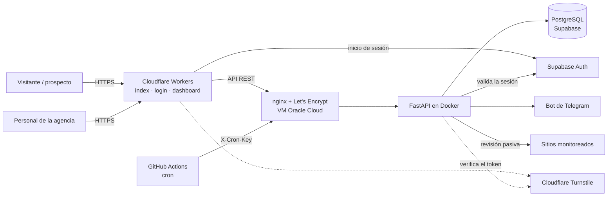

# Especificación de requerimientos

| | |
|---|---|
| **Proyecto** | Sistema web de diagnóstico y monitoreo de sitios web para optimizar el mantenimiento y la captación de clientes en una agencia de marketing digital, Lima 2026 |
| **Organización** | Grupo ConsigueVentas Inversiones E.I.R.L. |
| **Autor** | Giovanni Joaquín Garcilazo López · Ingeniería de Sistemas, Universidad César Vallejo |
| **Versión** | 1.0 |
| **Fecha** | 14/10/2026 |

**Leyenda de estado:** ✅ Implementado · 🟡 Parcial · ⏳ Pendiente

---

## 1. Introducción

### 1.1 Propósito

Este documento describe qué debe hacer el sistema (requerimientos funcionales), bajo qué condiciones debe hacerlo (reglas de negocio y requerimientos no funcionales) y cómo se relaciona cada requerimiento con los componentes construidos.

### 1.2 Alcance

El sistema tiene dos módulos que comparten la misma base de datos y el mismo servidor:

1. **Monitoreo interno.** Revisa de forma periódica los sitios web de los clientes de la agencia (disponibilidad, certificado SSL y tiempo de respuesta), guarda el historial, muestra el estado en un panel con acceso restringido y avisa por Telegram cuando algo cambia.
2. **Diagnóstico público con captación de leads.** Una página abierta donde cualquier persona analiza su sitio web de forma gratuita y recibe un puntaje en cinco categorías. Para ver el informe completo deja sus datos de contacto, que quedan registrados para la agencia.

El sistema realiza únicamente **revisiones pasivas desde el exterior**: observa lo que cualquier visitante puede ver. No accede al interior de los sitios analizados ni los modifica.

---

## 2. Descripción general

### 2.1 Actores

| Actor | Descripción |
|---|---|
| **Administrador** | Personal de la agencia con acceso completo al panel. |
| **Lector** | Personal de la agencia que consulta el panel sin administrar. |
| **Visitante / prospecto** | Persona externa que usa el diagnóstico gratuito. No tiene cuenta. |
| **Planificador** | Proceso automático (GitHub Actions) que dispara los chequeos programados. |

### 2.2 Restricciones y supuestos

- **Costo cero:** toda la infraestructura utiliza planes gratuitos.
- El monitoreo se hace desde fuera de los sitios; no se requiere acceso a su contenido interno.
- La agencia autoriza el monitoreo de los sitios de sus clientes que se registran en el sistema.
- El servidor (VM de Oracle Cloud) permanece encendido las 24 horas.
- Algunos hostings bloquean las visitas automáticas (HTTP 403). El sistema simula las cabeceras de un navegador para reducir estos falsos positivos.

---

## 3. Requerimientos funcionales

### 3.1 Panel interno

| ID | Requerimiento | Prioridad | Estado |
|---|---|---|---|
| RF-01 | Autenticación con correo y contraseña (Supabase Auth). El registro público está deshabilitado; las cuentas las crea un administrador. | Alta | ✅ |
| RF-02 | Control de acceso por roles (`admin` y `lector`). Una cuenta sin rol no accede y ve un mensaje claro. | Alta | ✅ |
| RF-03 | Registrar sitios a monitorear (nombre del cliente y URL). | Alta | 🟡 API lista; falta la interfaz |
| RF-04 | Ocultar y eliminar sitios. Un sitio oculto sigue monitoreado pero no se muestra en el panel. | Media | 🟡 API lista; falta la interfaz |
| RF-05 | Chequeo de disponibilidad: código HTTP y tiempo de respuesta, con cabeceras de navegador. | Alta | ✅ |
| RF-06 | Verificación del certificado SSL y de los días restantes para su vencimiento. | Alta | ✅ |
| RF-07 | Chequeos automáticos programados (GitHub Actions) y manuales (individual y masivo). | Alta | ✅ |
| RF-08 | Historial de chequeos por sitio. | Alta | ✅ |
| RF-09 | Alertas por Telegram: un solo mensaje resumen por ronda, solo ante cambios de estado, y aviso de SSL por vencer. | Alta | ✅ |
| RF-10 | Resumen general (sitios registrados, disponibles y caídos), con filtro al pulsar cada tarjeta. | Media | ✅ |
| RF-11 | Búsqueda por nombre o URL, filtros por estado y ordenamiento (nombre, caídos primero, más lentos, SSL por vencer). | Media | ✅ |
| RF-12 | Detalle por sitio: disponibilidad a 30 y 7 días, tendencia del tiempo de respuesta, última caída e historial reciente. | Media | ✅ |
| RF-13 | Navegación por secciones: Panel, Sitios, Incidentes y Usuarios. | Media | 🟡 Solo Panel tiene contenido |
| RF-14 | Gestión de usuarios y roles desde el panel. | Media | ⏳ Hoy se gestiona en Supabase |
| RF-15 | Registro de incidentes (cuándo cayó cada sitio y cuánto duró). | Media | ⏳ |
| RF-16 | Revisión de enlaces rotos. | Baja | ⏳ |
| RF-17 | Puntaje de PageSpeed Insights (rendimiento y Core Web Vitals). | Baja | ⏳ |

### 3.2 Diagnóstico público y captación de leads

| ID | Requerimiento | Prioridad | Estado |
|---|---|---|---|
| RF-18 | Página pública donde se escribe una URL y se analiza sin registro. | Alta | ✅ |
| RF-19 | Diagnóstico con puntaje global y cinco categorías: Disponibilidad, Certificado SSL, Velocidad, Seguridad y SEO y móvil. | Alta | ✅ |
| RF-20 | Vista previa gratuita (puntajes y resúmenes) e informe completo con hallazgos, «por qué importa» y «cómo corregirlo» una vez que el visitante deja sus datos con consentimiento. | Alta | ✅ |
| RF-21 | Registro del lead en la base de datos: nombre, correo, teléfono (opcional), sitio analizado, puntaje y consentimiento. | Alta | ✅ |
| RF-22 | Aviso por Telegram de cada nuevo lead. | Media | ✅ |
| RF-23 | Protección contra bots: Cloudflare Turnstile y campo trampa en el formulario. | Alta | ✅ |
| RF-24 | Acceso interno a la aplicación desde la página pública, oculto a los visitantes. | Baja | ✅ |
| RF-25 | Gestión de leads en el panel (ver, cambiar estado, anotar seguimiento). | Alta | ⏳ |
| RF-26 | Informe descargable en PDF. | Baja | ⏳ |
| RF-27 | Política de privacidad visible desde el formulario. | Alta | ⏳ |

---

## 4. Reglas de negocio

| ID | Regla |
|---|---|
| RN-01 | Un sitio está **disponible** si responde con un código HTTP menor a 400. En el diagnóstico público, los códigos 401, 403 y 429 se interpretan como «bloquea visitas automáticas» (60 puntos) y no como caída. |
| RN-02 | La alerta de **caída o recuperación** se envía solo cuando el estado cambia respecto del chequeo anterior. |
| RN-03 | La alerta de **SSL por vencer** se envía cuando faltan 15 días o menos y el número de días cambió respecto del chequeo anterior. |
| RN-04 | El aviso de **sitio lento** (más de 3000 ms) se envía en el chequeo individual («Chequear ahora»). |
| RN-05 | En el chequeo masivo se envía **un único mensaje resumen** por ronda, y ninguno si no hay novedades. |
| RN-06 | La **disponibilidad (uptime)** es el cociente entre chequeos disponibles y chequeos totales de los últimos 7 y 30 días, con días calculados en hora de Lima (UTC−5). |
| RN-07 | Sin rol asignado no hay acceso (error 403). El rol se guarda en los metadatos de aplicación (`app_metadata.rol`) de cada usuario en Supabase. |
| RN-08 | El **puntaje global** es el promedio ponderado: Disponibilidad 25 %, SSL 20 %, Velocidad 20 %, Seguridad 20 %, SEO y móvil 15 %. Estados: 80 o más = Bien, 50 a 79 = Mejorable, menos de 50 = Crítico. Si el sitio usa HTTPS, Seguridad nunca se muestra como Crítico. |
| RN-09 | **SSL:** más de 30 días = 100; de 16 a 30 días = 70; 15 días o menos = 40; vencido o sin HTTPS = 0. |
| RN-10 | **Velocidad:** se mide hasta tres veces y se usa la mediana. Hasta 800 ms = 100; hasta 1500 ms = 85; hasta 2500 ms = 65; hasta 4000 ms = 40; más de 4000 ms = 20. Descuentos: sin compresión −10, sin caché −5, página pesada −5. |
| RN-11 | **Seguridad** (8 comprobaciones, pesos entre paréntesis): redirección de http a https (10), HSTS (20), protección contra clickjacking (20), nosniff (15), política de contenido CSP (10), política de referrer (10), política de permisos (5) y no exponer versiones de software (10). Una CSP que solo contenga `upgrade-insecure-requests` se considera incompleta. |
| RN-12 | **SEO y móvil** (8 comprobaciones): título (15), meta descripción (15), viewport (15), encabezado H1 (10), HTTPS (10), Open Graph (15), `robots.txt` (10) y `sitemap` (10). Las comprobaciones que no se pueden verificar se excluyen del cálculo. |
| RN-13 | El **informe completo** solo se entrega después de registrar un lead con consentimiento. El análisis permanece en memoria hasta 1 hora. |
| RN-14 | Límites del diagnóstico público: 3 análisis por hora por IP, 40 por hora en total, 2 simultáneos y 5 registros de lead por hora por IP. Además, nginx limita a 6 solicitudes por minuto por IP. |
| RN-15 | Cada análisis descarga como máximo 300 KB, sigue hasta 3 redirecciones y solo acepta los puertos 80 y 443. Se bloquean las direcciones que no son públicas (red local, loopback, metadatos de la nube), también en cada redirección. |
| RN-16 | El diagnóstico público se puede apagar con la variable `AUDITORIA_PUBLICA=off`. |

---

## 5. Requerimientos no funcionales

| ID | Categoría | Requerimiento | Cómo se cumple |
|---|---|---|---|
| RNF-01 | Costo | La infraestructura no debe tener costo. | Supabase Free, Oracle Cloud Always Free, Cloudflare (Workers y Turnstile), GitHub (repositorio y Actions), DuckDNS, Let's Encrypt y la API de bots de Telegram. |
| RNF-02 | Seguridad | Toda comunicación debe ir cifrada. | HTTPS con certificado de Let's Encrypt en el servidor y en el frontend. |
| RNF-03 | Seguridad | La API interna solo responde a usuarios autenticados y con rol. | Cada petición lleva el token de sesión de Supabase; el backend lo valida y comprueba el rol. |
| RNF-04 | Seguridad | El proceso programado no debe usar cuentas de personas. | Clave de servicio independiente (`X-Cron-Key`) guardada como secreto de GitHub, válida solo para el chequeo masivo. |
| RNF-05 | Seguridad | Los datos personales de los leads no deben ser legibles desde la API pública de la base. | RLS activado en todas las tablas; el backend accede con su propia conexión. |
| RNF-06 | Seguridad | Los secretos no deben estar en el repositorio. | Variables de entorno en la VM (`.env`) y secretos de GitHub. |
| RNF-07 | Seguridad | El endpoint público debe resistir abuso y no permitir ataques a la red interna. | Validación anti-SSRF, límites por IP en la aplicación y en nginx, tope de descarga, interruptor, CAPTCHA y campo trampa. |
| RNF-08 | Rendimiento | El diagnóstico debe completarse en pocos segundos. | Medido en 7,8 s en pruebas, con presupuesto máximo de 14 s para comprobaciones extra. |
| RNF-09 | Rendimiento | El backend debe funcionar con recursos mínimos. | Contenedor limitado a 200 MB de memoria. |
| RNF-10 | Disponibilidad | El servicio se recupera solo ante reinicios. | Contenedor con política `unless-stopped`. |
| RNF-11 | Usabilidad | Interfaz clara, adaptable a pantallas grandes y celulares, con mensajes de error en español. | Diseño responsive con tema oscuro y estados de carga, vacío y error. |
| RNF-12 | Mantenibilidad | Cambios de base de datos versionados y código por capas. | Migraciones con Alembic; estructura `routers`, `services`, `models` y `schemas`. |
| RNF-13 | Privacidad | El tratamiento de datos requiere consentimiento y debe ser transparente. | Casilla de consentimiento obligatoria y aviso en la página. Falta la política de privacidad (RF-27). |
| RNF-14 | Compatibilidad | Funciona en los navegadores actuales. | Chrome, Edge y Firefox recientes. |

---

## 6. Arquitectura

### Tecnologías

| Capa | Tecnología |
|---|---|
| Frontend | HTML, CSS y JavaScript sin frameworks, publicado en Cloudflare Workers |
| Backend | Python 3.11, FastAPI, SQLAlchemy, Pydantic y httpx |
| Base de datos | PostgreSQL en Supabase (región São Paulo), migraciones con Alembic |
| Autenticación | Supabase Auth con correo y contraseña; roles en `app_metadata` |
| Despliegue | Docker en una VM de Oracle Cloud, nginx como proxy inverso con HTTPS |
| Automatización | GitHub Actions (cron) |
| Alertas | Bot de Telegram |
| Anti-abuso | Cloudflare Turnstile, límites de nginx y de la aplicación |

---

## 7. Modelo de datos

**`sitios`**

| Campo | Descripción |
|---|---|
| `id` | Identificador |
| `nombre_cliente` | Nombre del cliente |
| `url` | Dirección del sitio |
| `activo` | Si se incluye en los chequeos masivos |
| `oculto` | Si se oculta en el panel (sigue monitoreado) |
| `creado_en` | Fecha de registro |

**`chequeos`**

| Campo | Descripción |
|---|---|
| `id` | Identificador |
| `sitio_id` | Sitio al que pertenece (clave foránea) |
| `disponible` | Si respondió correctamente |
| `codigo_http` | Código de respuesta |
| `tiempo_respuesta_ms` | Tiempo de respuesta en milisegundos |
| `ssl_dias_restantes` | Días restantes del certificado |
| `puntaje_pagespeed` | Reservado para PageSpeed (pendiente) |
| `ejecutado_en` | Fecha y hora del chequeo |

**`leads`**

| Campo | Descripción |
|---|---|
| `id` | Identificador |
| `nombre`, `correo`, `telefono` | Datos de contacto (el teléfono es opcional) |
| `url_analizada` | Sitio que analizó el visitante |
| `puntaje_global` | Puntaje obtenido en el diagnóstico |
| `consentimiento` | Aceptación del tratamiento de datos |
| `estado` | Seguimiento comercial (inicia en `nuevo`) |
| `notas` | Observaciones del equipo |
| `creado_en` | Fecha de registro |

Los usuarios y sus roles no tienen tabla propia: los administra Supabase Auth (`auth.users`).

---

## 8. Interfaz de programación (API)

La documentación interactiva está disponible en `/api/docs`.

| Método | Ruta | Acceso | Descripción |
|---|---|---|---|
| GET | `/` | Público | Comprobación de que la API funciona |
| GET | `/me` | Usuario con rol | Correo y rol de la sesión actual |
| GET | `/sitios/` | Usuario con rol | Lista de sitios |
| POST | `/sitios/` | Usuario con rol | Registrar un sitio |
| DELETE | `/sitios/{id}` | Usuario con rol | Eliminar un sitio y sus chequeos |
| POST | `/chequeos/ejecutar/{id}` | Usuario con rol | Chequear un sitio |
| POST | `/chequeos/ejecutar-todos` | Usuario con rol o clave de servicio | Chequear todos los sitios activos |
| GET | `/chequeos/sitio/{id}` | Usuario con rol | Historial de un sitio |
| GET | `/chequeos/uptime` | Usuario con rol | Disponibilidad a 7 y 30 días |
| POST | `/publico/auditoria` | Público (con Turnstile) | Analiza una URL y devuelve la vista previa |
| POST | `/publico/leads` | Público (con análisis válido) | Registra un lead y devuelve el informe completo |

---

## 9. Trazabilidad

| Requerimientos | Componentes |
|---|---|
| RF-01, RF-02 | `backend/app/auth.py`, `frontend/login.html`, `frontend/assets/js/auth.js` |
| RF-03, RF-04 | `backend/app/routers/sitios.py`, `models/sitio.py`, `schemas/sitio_schema.py` |
| RF-05 | `backend/app/services/monitor.py` |
| RF-06 | `backend/app/services/ssl_checker.py` |
| RF-07, RF-08, RF-12 | `backend/app/routers/chequeos.py`, `.github/workflows/chequeo-programado.yml` |
| RF-09 | `backend/app/services/alertas.py`, `telegram_bot.py` |
| RF-10, RF-11, RF-13 | `frontend/dashboard.html`, `frontend/assets/js/dashboard.js`, `frontend/assets/css/style.css` |
| RF-18 a RF-20 | `backend/app/services/auditoria_publica.py`, `routers/publico.py`, `frontend/index.html` |
| RF-21, RF-22 | `backend/app/models/lead.py`, `schemas/lead_schema.py`, `routers/publico.py` |
| RF-23 | `routers/publico.py` (verificación de Turnstile), `frontend/index.html` |
| RNF-02, RNF-07 | `infra/nginx`, `backend/app/routers/publico.py` |

---

## 10. Pendientes y mejoras

1. **Permisos de escritura por rol.** Hoy el rol `lector` puede, mediante la API, registrar y eliminar sitios. Debe restringirse al rol `admin` al construir la sección Sitios.
2. Secciones **Sitios**, **Leads**, **Incidentes** y **Usuarios** del panel.
3. Integración con **PageSpeed Insights** y revisión de **seguridad del correo** (SPF y DMARC).
4. **Política de privacidad** y revisión de las obligaciones de la Ley N.° 29733 de protección de datos personales.
5. **Dominio propio** para la página pública, con el fin de evitar las advertencias de los navegadores sobre subdominios gratuitos.
6. **CI/CD:** pruebas automáticas en GitHub Actions y despliegue del backend sin pasos manuales.
7. **Observabilidad:** comprobación de que el propio servidor está vivo (healthchecks).
8. Informe del diagnóstico en **PDF**.
